<div align="center">

[][vsmp-link]

<br />

</div>

<br />

# DMI Studio

This project is a DMI (BYOND's Dream Maker icon files) editor extension for desktop [VS Code](https://code.visualstudio.com).
It focuses on group operations: reordering states, adjusting animation delays, and shifting pixels across many selected frames at once.

Based on [AnturK/dmiEditor](https://github.com/AnturK/dmiEditor) 1.0.10 (commit `851d505`).

## Download

The latest `.vsix` is available from the Releases page of this repository.

Works in desktop VS Code only.

## Usage

### Quickstart

1. **Install the extension:**
	- Run `Extensions: Install from VSIX…` from the command palette and pick the downloaded file, or run `code --install-extension dmi-studio-<version>.vsix` with the downloaded version number.
2. **Open or create a DMI file:**
	- Open a `.dmi` as you would any other file. If it shows up as binary or in another editor, use `Open With… > DMI Studio`
	- To create a new one, open a project folder and run `DMI Studio: Create DMI File`

### Features

- Select several states or frames: Ctrl/Cmd-click toggles, Shift-click selects a range, Ctrl/Cmd+A selects everything in the current view (only the matches when a filter is active)
- Open a state by double-clicking its sprite, rename it by double-clicking its name
- Reorder states by dragging to the insertion line between cards, including across rows, or with the arrow buttons. A selected group moves as a block and keeps its order
- Sort states with `Sort` or `DMI Studio: Sort States`. Sorting ignores case and puts `walk2` before `walk10`
- Reorder animation frames: click a column number to select all its directions, then drag it or use the arrow buttons. Delays and hotspots move with the column
- Shift pixels across all selected frames. Pixels past the frame edges are clipped, the vacated area becomes transparent, delays and hotspots stay in place
- Cut, copy and paste groups of states or frames, including between open DMIs
- Change DMI dimensions, frame and direction counts, delays, loop count, and the movement and rewind flags
- Search, zoom, checkerboard background, choice of preview direction, duplicate names flagged in the list
- Each group edit takes one undo step
- Read-only viewing: `Open With… > DMI Studio Preview`, or `Compare` to diff two DMI files. Compare marks added, removed, changed and reordered states, and clicking a sprite shows its frames and settings

### Copy and paste

Right-click a sprite or frame for `Cut`, `Copy` and `Paste`. Right-clicking a selected item keeps the selection, so the action applies to the whole group. Right-clicking an unselected item selects it first.

**In the state list**, paste inserts after the last selected state, or at the end if nothing is selected. Copies keep names, directions, frames, delays, loops, flags and hotspots. Copying between open DMIs requires matching frame sizes.

**Inside a state**, each cell is one direction at one point in the animation. Cut clears the selected cells and keeps the animation length. Paste depends on what is selected:

- One cell: pastes the whole group with its original positions in time and direction rows, adding columns on the right as needed
- Several cells, one copied: fills every selected cell with that image
- As many cells as were copied: replaces them pairwise in on-screen row order

Pasting into cells replaces pixels only. Delays and hotspots belong to columns and stay put.

### PNG

PNG sheets use the DMI frame size as the tile size, so both image dimensions must be exact multiples of it.

- In the state list, paste creates one state per tile, in row order
- In the frame grid, image rows map to directions when they fit. Larger sheets fill consecutive frames in the destination direction

### Clipboard format

The full selection goes to the clipboard as `text/plain`: the header `DMI Studio clipboard/1`, a newline, then JSON. This is what lets a group paste between windows. If the webview allows image access, Copy also exports the first selected item as `image/png`.

## Building the Project

### Requirements

- [Git](https://git-scm.com)
- [Node.js](https://nodejs.org) 22.12+ or 24 LTS

```sh
npm ci
npm test -- --runInBand
npm run package
```

The VSIX ends up in the repo root. To debug, open the folder in VS Code and run `Run Extension` (F5).

Two build details worth knowing: the pinned png-codec fork writes BYOND's compressed `Description` chunk right after `IHDR`, and esbuild bundles the Codicon stylesheet and font from the editor's CSS import.

## License

**GPL-3.0**, for more details see the [LICENSE](./LICENSE).

Originally created by [AnturK](https://github.com/AnturK) at https://github.com/AnturK/dmiEditor

[vsmp-link]: https://marketplace.visualstudio.com/items?itemName=quinethor.dmi-studio
